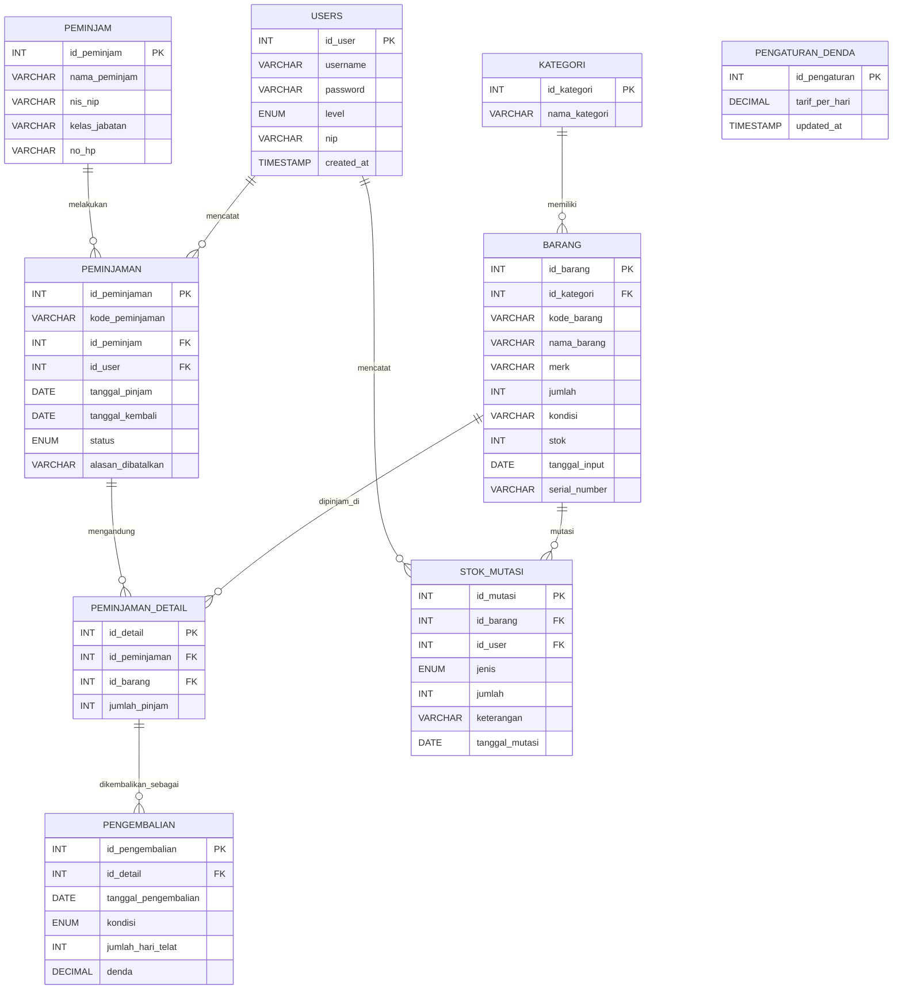

# Database Schema Final & Arsitektur Sistem
## Sistem Inventory Laboratorium Komputer Berbasis Mobile — SMK Al-Madani (Aplikasi: "Inventory Labkom")

| | |
|---|---|
| **Versi** | 1.5 (Final — hasil review Flowchart/Use Case/Activity/Sequence Diagram skripsi asli) |
| **Rujukan** | PRD_Sistem_Inventory_Lab_SMK_AlMadani.md v1.6 |

---

## 1. Ringkasan Perubahan dari Draft Awal

| Perubahan | Alasan |
|---|---|
| Tabel `peminjaman` jadi header transaksi saja (tanpa `id_barang` langsung) | 1 peminjam bisa pinjam banyak barang sekaligus |
| Tabel baru `peminjaman_detail` | Pivot: menyimpan barang + jumlah per transaksi peminjaman |
| Tabel `pengembalian` mengacu ke `peminjaman_detail`, bukan `peminjaman` | Kondisi & denda bisa beda tiap barang dalam satu transaksi |
| Tabel baru `pengaturan_denda` | Menyimpan tarif denda/hari agar perhitungan otomatis bisa dikonfigurasi tanpa ubah kode |
| `users.password` → `VARCHAR(255)` | Menampung hash bcrypt, bukan plaintext |
| `peminjaman.status` ditambah `menunggu_verifikasi` & `dibatalkan` (bukan `ditolak`) | Mendukung alur verifikasi; penamaan `dibatalkan` mengikuti mockup asli skripsi, ditambahkan sebagai status ekstr[...]
| `peminjam` ditambah `nis_nip` & `kelas_jabatan` | Ditemukan di mockup asli skripsi (Gambar 3.25 — layar Kelola Peminjam), belum ada di draft awal |
| Tabel `users` dikelola lewat fitur baru **Kelola User** | Ditemukan di mockup dashboard asli skripsi — terpisah dari Data Peminjam (peminjam = subjek yang meminjam barang; user = akun login Labora[...]

---

## 2. ERD (Relasi Antar Tabel)

```
users ─────────────< peminjaman
kategori ──────────< barang
barang ─────────────< peminjaman_detail >───── peminjaman
peminjam ───────────< peminjaman
peminjaman_detail ──< pengembalian
```

Penjelasan alur: satu **peminjaman** (1 peminjam, dicatat 1 laboran) memiliki banyak **peminjaman_detail** (satu baris per barang). Saat barang dikembalikan, tiap `peminjaman_detail` punya satu ba[...]

---

### Mermaid ER Diagram



---

## 3. Skema Tabel Final

### 3.1 `users` (akun login — dikelola lewat fitur Kelola User)
| Field | Tipe | Keterangan |
|---|---|---|
| id_user | INT(11) PK AUTO_INCREMENT | |
| username | VARCHAR(50) UNIQUE | |
| password | VARCHAR(255) | Disimpan sebagai hash (bcrypt) |
| level | ENUM('admin','super_admin') | admin = Laboran, super_admin = Kepala Program |
| nip | VARCHAR(30) NULL | **Rekomendasi baru** (hasil review desain Figma) — dipakai sebagai alternatif identitas login ("Username / NIP") |
| created_at | TIMESTAMP DEFAULT CURRENT_TIMESTAMP | |

### 3.2 `kategori`
| Field | Tipe | Keterangan |
|---|---|---|
| id_kategori | INT(11) PK AUTO_INCREMENT | |
| nama_kategori | VARCHAR(100) | Contoh dari mockup: Komputer, Jaringan, Elektronik |

### 3.3 `barang`
| Field | Tipe | Keterangan |
|---|---|---|
| id_barang | INT(11) PK AUTO_INCREMENT | |
| id_kategori | INT(11) FK → kategori.id_kategori | |
| kode_barang | VARCHAR(30) UNIQUE | Contoh dari mockup: A01, A02 |
| nama_barang | VARCHAR(100) | |
| merk | VARCHAR(100) | |
| jumlah | INT(11) | Jumlah total unit dimiliki |
| kondisi | VARCHAR(50) | Kondisi umum barang |
| stok | INT(11) | Stok tersedia (berkurang saat dipinjam, bertambah saat kembali) |
| tanggal_input | DATE | |
| serial_number | VARCHAR(50) NULL | **Rekomendasi baru** (hasil review desain Figma) — SN per unit barang, opsional |

### 3.4 `peminjam` (subjek peminjam — UPDATE: tambah 2 field baru)
| Field | Tipe | Keterangan |
|---|---|---|
| id_peminjam | INT(11) PK AUTO_INCREMENT | |
| nama_peminjam | VARCHAR(100) | |
| nis_nip | VARCHAR(30) | **BARU** — ditemukan di mockup asli: NIS untuk siswa, NIP untuk guru/staf |
| kelas_jabatan | VARCHAR(50) | **BARU** — contoh dari mockup: "XII TKJ 1" (siswa) atau nama jabatan (guru/staf) |
| no_hp | VARCHAR(20) | |

> Beda dengan `users`: `peminjam` bukan akun yang bisa login ke aplikasi — murni data siapa yang meminjam barang (siswa/guru/staf lab).

### 3.5 `peminjaman` (header transaksi)
| Field | Tipe | Keterangan |
|---|---|---|
| id_peminjaman | INT(11) PK AUTO_INCREMENT | |
| kode_peminjaman | VARCHAR(20) UNIQUE | Format sesuai mockup: `PMJ-2026-001` (generate otomatis) |
| id_peminjam | INT(11) FK → peminjam.id_peminjam | |
| id_user | INT(11) FK → users.id_user | Laboran yang mencatat |
| tanggal_pinjam | DATE | |
| tanggal_kembali | DATE | Rencana/jatuh tempo (ditampilkan sebagai "Jatuh Tempo" di list Peminjaman, sesuai mockup) |
| status | ENUM('menunggu_verifikasi','dipinjam','sebagian_kembali','dikembalikan','dibatalkan') | Lihat §3.5.1 |
| alasan_dibatalkan | VARCHAR(255) NULL | **BARU** — ditemukan di mockup (list Peminjaman menampilkan "Alasan Dibatalkan"), diisi saat Kepala Program reject |

#### 3.5.1 Alur Status `peminjaman`

```
[Laban buat transaksi] → status = menunggu_verifikasi (stok langsung berkurang)
            │
            ▼
   Kepala Program verifikasi
   ┌────────┴────────┐
   ▼                 ▼
 Approve           Reject
   │                 │
   ▼                 ▼
status=dipinjam   status=dibatalkan
                  + alasan_dibatalkan diisi
                  + stok barang dikembalikan
                  otomatis oleh sistem
```

Setelah `dipinjam`, status lanjut berubah jadi `sebagian_kembali` atau `dikembalikan` mengikuti proses pengembalian per-item (lihat §3.7).

> **Catatan tampilan (dikonfirmasi klien)**: layar "Peminjaman" di mockup asli hanya punya tab Semua/Dipinjam/Dikembalikan/Dibatalkan — tab **"Menunggu Verifikasi"** ditambahkan sebagai tab ekstra d[...]

### 3.6 `peminjaman_detail` (pivot multi-barang)
| Field | Tipe | Keterangan |
|---|---|---|
| id_detail | INT(11) PK AUTO_INCREMENT | |
| id_peminjaman | INT(11) FK → peminjaman.id_peminjaman | |
| id_barang | INT(11) FK → barang.id_barang | |
| jumlah_pinjam | INT(11) | Jumlah unit barang ini yang dipinjam |

### 3.7 `pengembalian` (mengacu ke detail, bukan header)
| Field | Tipe | Keterangan |
|---|---|---|
| id_pengembalian | INT(11) PK AUTO_INCREMENT | |
| id_detail | INT(11) FK → peminjaman_detail.id_detail | |
| tanggal_pengembalian | DATE | Tanggal aktual barang ini dikembalikan |
| kondisi | ENUM('baik','rusak') | |
| jumlah_hari_telat | INT(11) | Dihitung otomatis: `tanggal_pengembalian - peminjaman.tanggal_kembali` (jika > 0) |
| denda | DECIMAL(10,2) | Dihitung otomatis: `jumlah_hari_telat × pengaturan_denda.tarif_per_hari` |

#### 3.7.1 Status Tampilan Layar "Pengembalian" (turunan, bukan kolom fisik)

Layar Pengembalian di mockup asli punya tab: Semua / Belum Kembali / Sudah Kembali / Terlambat — dihitung on-the-fly dari data `peminjaman` + `peminjaman_detail` + `pengembalian` (bukan kolom b[...]
| Tab | Kondisi |
|---|---|
| Belum Kembali | Ada `peminjaman_detail` yang belum punya baris `pengembalian`, dan belum lewat `tanggal_kembali` |
| **Sebagian Kembali** *(BARU — tab tambahan, dikonfirmasi klien)* | Sebagian `peminjaman_detail` dalam 1 transaksi sudah punya `pengembalian`, sebagian belum |
| Sudah Kembali | Semua `peminjaman_detail` dalam transaksi sudah punya `pengembalian` |
| Terlambat | Ada `peminjaman_detail` yang belum kembali dan sudah lewat `tanggal_kembali` |

### 3.8 `pengaturan_denda` (konfigurasi tarif)
| Field | Tipe | Keterangan |
|---|---|---|
| id_pengaturan | INT(11) PK AUTO_INCREMENT | |
| tarif_per_hari | DECIMAL(10,2) | Nominal denda per hari keterlambatan, per barang. Diisi default via `seed.sql`, bisa diubah lewat endpoint pengaturan |
| updated_at | TIMESTAMP | |

> Logika perhitungan denda ada di **backend** (bukan trigger DB): saat Laboran input tanggal pengembalian aktual, sistem otomatis membandingkan dengan `tanggal_kembali` di header peminjaman, lalu kali[...]

### 3.9 `stok_mutasi` (BARU — hasil review Flowchart System asli skripsi)
| Field | Tipe | Keterangan |
|---|---|---|
| id_mutasi | INT(11) PK AUTO_INCREMENT | |
| id_barang | INT(11) FK → barang.id_barang | |
| id_user | INT(11) FK → users.id_user | Laboran yang mencatat mutasi |
| jenis | ENUM('masuk','keluar') | Masuk = penambahan stok (pengadaan baru dll), Keluar = pengurangan stok (rusak/hilang dll) |
| jumlah | INT(11) | Jumlah unit yang dimutasi |
| keterangan | VARCHAR(255) | Alasan mutasi (contoh: "Pengadaan APBD 2026", "Rusak — dibuang") |
| tanggal_mutasi | DATE | |

> Setiap mutasi otomatis update `barang.stok` (`+jumlah` untuk masuk, `-jumlah` untuk keluar — backend validasi stok tidak boleh negatif). Ini **terpisah** dari perubahan stok akibat transaksi Pemin[...]

---

## 4. Arsitektur Sistem


- **Autentikasi**: login mengembalikan JWT token, disimpan di secure storage Flutter, dikirim di header `Authorization: Bearer <token>` tiap request. Opsi "Ingat saya" (dari mockup) memperpanjang masa[...]
- **Lupa Password**: karena app ini dipakai internal sekolah (2 role saja), alur reset disarankan sederhana — Laboran (yang punya akses Kelola User) bisa reset password akun lain secara manual lewat[...]
- **Otorisasi berbasis role**: setiap endpoint backend memvalidasi `level` user dari token — Kepala Program tidak bisa mengakses endpoint kelola barang/peminjam/user/pengaturan denda meski tahu URL-[...]
- **Export laporan (final)**: digenerate di **backend** — PDF via `mPDF`/`TCPDF`, Word via `PHPWord`, **Excel via `PhpSpreadsheet`** (ditambahkan hasil review desain — laporan sekarang 3 format).

### 4.1 Ringkasan Endpoint API (per fitur PRD)

| Fitur (FR) | Endpoint (contoh) | Method |
|---|---|---|
| Login | `/api/auth/login` | POST (body tambahan: `remember_me: bool`) |
| Kelola User | `/api/users` | GET, POST, PUT, DELETE (**khusus Laboran/admin**) |
| Kelola Barang | `/api/barang` | GET, POST, PUT, DELETE |
| Kelola Stok Barang (Mutasi) | `/api/stok-mutasi` | GET (riwayat), POST (catat mutasi masuk/keluar → update `barang.stok` otomatis) |
| Kelola Kategori | `/api/kategori` | GET, POST, PUT, DELETE |
| Kelola Peminjam | `/api/peminjam` | GET, POST, PUT, DELETE (body tambahan: `nis_nip`, `kelas_jabatan`) |
| Peminjaman (multi-item) | `/api/peminjaman` | POST (body: id_peminjam + array barang & jumlah) → status awal `menunggu_verifikasi` |
| Pengembalian per item | `/api/pengembalian` | POST (body: id_detail, kondisi, tanggal_pengembalian) |
| Verifikasi | `/api/peminjaman/{id}/verifikasi` | PATCH (body: `approve` atau `reject` + `alasan` jika reject; reject → status `dibatalkan`, restore stok otomatis) |
| Laporan Data Barang | `/api/laporan/barang?format=pdf\|docx\|xlsx` | GET |
| Laporan Peminjaman | `/api/laporan/peminjaman?format=pdf\|docx\|xlsx` | GET |
| Laporan Pengembalian | `/api/laporan/pengembalian?format=pdf\|docx\|xlsx` | GET |
| Laporan Stok Barang | `/api/laporan/stok?format=pdf\|docx\|xlsx` | GET |
| Laporan Denda | `/api/laporan/denda?format=pdf\|docx\|xlsx` | GET |
| Pengaturan Denda | `/api/pengaturan-denda` | GET, PUT (**khusus Laboran/admin**) |

### 4.2 Struktur Repository (untuk deliverable GitHub)

```
inventory-labkom/
├── mobile/           # Source code Flutter
├── backend/          # Source code REST API PHP
├── database/
│   ├── schema.sql    # Struktur tabel (DDL)
│   └── seed.sql       # Data contoh untuk testing
├── docs/
│   ├── INSTALLATION.md   # Cara setup XAMPP, import DB, konfigurasi backend
│   ├── CONFIGURATION.md  # Konfigurasi koneksi DB, JWT secret, tarif denda awal
│   └── USER_GUIDE.md     # Panduan pakai aplikasi per role (Laboran & Kepala Program)
└── README.md
```

GitHub Release akan berisi file `.apk` hasil build (`flutter build apk --release`), siap di-install langsung ke perangkat Android tanpa perlu source code.

---

## 5. Riwayat Keputusan Klien

### Putaran 1
| Item | Keputusan |
|---|---|
| Generator PDF/Word | Di backend — `mPDF`/`TCPDF` untuk PDF, `PHPWord` untuk Word |
| Status `sebagian_kembali` | Butuh badge/tampilan status khusus di UI Laboran |
| Nilai awal `tarif_per_hari` | Diisi lewat `seed.sql` sebagai default |

### Putaran 2
| Item | Keputusan | Alasan |
|---|---|---|
| Akses Pengaturan Denda | **Laboran (admin)** | Sesuai Use Case skripsi — Kepala Program hanya Verifikasi & Lihat Laporan |
| Notifikasi "Perlu Verifikasi" | Cukup badge, tanpa push notification | Skripsi tidak mendefinisikan fitur notifikasi |
| Reject Peminjaman | Stok otomatis dikembalikan | Konfirmasi klien |

### Putaran 3 (hasil cek mockup UI asli skripsi — Gambar 3.19–3.25)
| Item | Keputusan | Alasan |
|---|---|---|
| Nama aplikasi | **"Inventory Labkom"** | Sesuai mockup Login asli |
| Dashboard | Grid menu ikon (bukan kartu ringkasan + bottom nav) | Sesuai mockup Dashboard asli |
| Peminjaman & Pengembalian | 2 menu/layar terpisah, masing-masing dengan filter status sendiri | Sesuai mockup asli |
| Penamaan status "ditolak" | Diganti jadi **"dibatalkan"** | Mengikuti istilah di mockup asli |
| Status `menunggu_verifikasi` & `sebagian_kembali` | **Ditambahkan sebagai tab ekstra** di luar tab dasar mockup (bukan menggantikan) | **Dikonfirmasi klien** |
| Field `peminjam` | Tambah `nis_nip` & `kelas_jabatan` | Ditemukan di mockup Kelola Peminjam asli |
| Fitur baru: Kelola User | Ditambahkan (FR-12 di PRD) — Laboran kelola akun login | Ditemukan di mockup Dashboard asli, terpisah dari Data Peminjam |
| Laporan | Diubah dari 2 jenis jadi **4 jenis**: Data Barang, Peminjaman, Pengembalian, Stok Barang | Sesuai mockup Laporan asli |
| Login | Tambah "Ingat saya" & "Lupa Password" | Sesuai mockup Login asli |

### Putaran 5 (hasil review desain Figma)
| Item | Keputusan |
|---|---|
| Multi-lab (dropdown, field lokasi) | Dihapus dari desain — tetap 1 lab |
| Barcode/QR scanner | Dihapus — dicek ke skripsi asli, cuma disebut di tinjauan pustaka, bukan fitur sistem. Tetap out-of-scope |
| Format Laporan | Diperluas jadi 3 format: PDF, Word, Excel (`PhpSpreadsheet`) |
| `barang.serial_number` & `users.nip` | Ditambahkan sebagai field opsional, hasil temuan dari desain Figma |

### Putaran 6 (hasil review Flowchart/Use Case/Activity/Sequence Diagram skripsi asli)
| Item | Keputusan |
|---|---|
| Fitur "Kelola Stok Barang" (ada di Flowchart, tidak ada di Use Case Table/mockup) | **Ditambahkan** sebagai FR-13 — tabel baru `stok_mutasi` (log masuk/keluar), endpoint `/api/stok-mutasi` |
| "Laporan Denda" (ada di Flowchart, tidak ada di 4 jenis laporan yang difinalisasi) | **Ditambahkan** jadi laporan ke-5 — endpoint `/api/laporan/denda` |
| Status `menunggu_verifikasi`, tombol "Setujui/Tolak" | **Divalidasi konsisten** dengan Activity & Sequence Diagram Verifikasi asli skripsi — tidak ada perubahan |
| Scope Kepala Program (Login/Verifikasi/Lihat Laporan) | **Divalidasi konsisten** dengan Tabel 3.1 Use Case resmi — tidak ada perubahan |

| **Status dokumen: FINAL.** Ada beberapa catatan minor tambahan (kode transaksi Pengembalian, dll) — detail lengkap ada di `UIUX_Wireframe_dan_Flow.md`.

---

## 6. Next Step

Lanjut ke **Sprint Planning / Task Breakdown** — pecah FR-01 s/d FR-13 jadi task teknis per sprint dengan estimasi.

```
